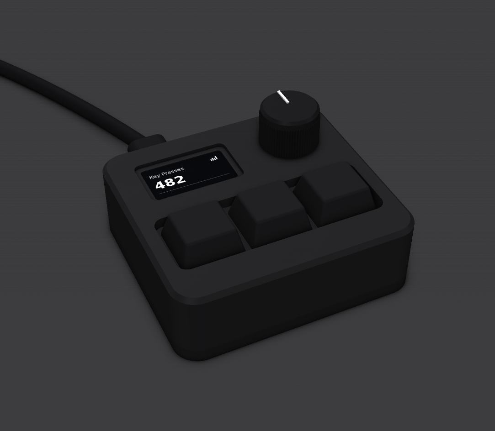
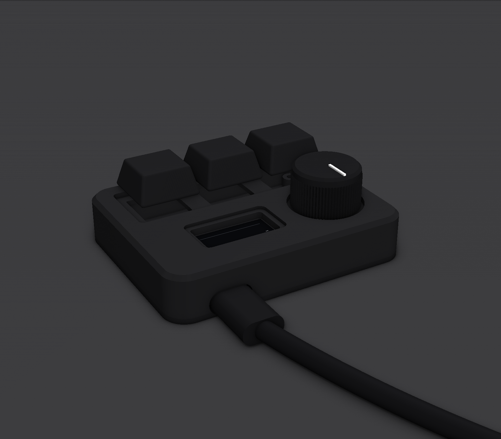

# SayoDevice O3C Case

A parametric matte black aluminium case for the SayoDevice O3C macropad, built in Python with [CadQuery](https://cadquery.readthedocs.io/).





## Design

- Two parts: a top shell and a flat bottom plate held together with M3 screws
- A single key opening with large corner radii, which keeps machining cheap
- A stepped bezel pocket around the 0.96" screen
- Knurled volume knob and a USB-C slot in the back wall

> **Note:** All dimensions are estimates. Measure your O3C's PCB with calipers and edit the parameters at the top of `Sayodevice-case.py` before ordering anything.

## Usage

Install the dependencies (first time only):

```
py -m pip install cadquery pillow
```

Run the script:

```
py Sayodevice-case.py
```

Files are written to `~/Downloads/o3c_case`.

## Output files

| File | Use |
|---|---|
| `o3c_case_top.step`, `o3c_case_bottom.step` | Send to a CNC shop for an aluminium quote |
| `o3c_case_bottom_lasercut.dxf` | 2D outline for laser cutting the bottom plate |
| `top.stl`, `bottom.stl` | 3D print these for a test fit before ordering metal |
| `keycaps`, `knob`, `knob_line`, `plug`, `cable`, `desk` `.stl` | Props for the render only |
| `o3c_case_render.png`, `o3c_case_render_back.png` | Preview renders |
| `screen.png` | Screen texture used in the render |

## Ordering notes

> **Before ordering anything:** measure your O3C's PCB and update the parameters, then 3D print `top.stl` and `bottom.stl` to check the fit. Reprinting plastic is much cheaper than remaking aluminium.

### Top shell (CNC machined)

Send `o3c_case_top.step`.

- **Tapped holes:** the 4 corner posts have 2.5 mm pilot holes that need an **M3 thread**. STEP files don't carry thread information, so ask for **4× M3 tapped holes, 8 mm deep** (add a note or a simple drawing with the order).
- **Material:** 6061 aluminium is the standard, cheapest choice.
- **Finish:** bead blast + **black anodise** for the matte black look.
- **Tolerances:** standard tolerances are fine. Don't pay for tight ones.

If you 3D print the top shell instead, change `SCREW_PILOT_D` to `4.0` and use M3 heat-set inserts.

### Bottom plate (laser cut)

Send `o3c_case_bottom_lasercut.dxf`.

> The bottom plate can also be CNC machined from `o3c_case_bottom.step`, which has the PCB standoffs built in (no brass standoffs needed). It also looks slightly cleaner: the standoff holes stop 1 mm short of the bottom, so only the 4 corner screws are visible underneath instead of 8. Laser cutting is usually much cheaper though, since it's just a flat cut-out.

- **Thickness:** 4 mm aluminium (`BOTTOM_H`). If the shop doesn't stock 4 mm, change `BOTTOM_H` to a thickness they do and re-run the script. This changes the case height and screw lengths.
- **Material:** 5052 or 6061 aluminium.
- **Units:** the DXF is in **millimetres**. Check the shop's preview shows the plate as 68 × 62 mm.
- **Countersinking:** all 8 holes need countersinking on the underside so the screw heads sit flush. Add it to the order if offered, otherwise do it by hand with a countersink bit.
- **Finish:** black anodise or powder coat to match the top, plus deburring.

### Hardware

| Qty | Part | Use |
|---|---|---|
| 4 | M3 × 10 countersunk screw | Bottom plate → top shell (from below) |
| 4 | M2 × 3 mm brass standoff, female-female | PCB standoffs |
| 4 | M2 × 4 countersunk screw | Standoffs → bottom plate (from below) |
| 4 | M2 × 4 screw | PCB → standoffs (from above) |
| 4 | Rubber feet (optional) | Grip on the desk, covers screw heads |

The M2 parts are only needed if the O3C's PCB has mounting holes. The `PCB_HOLES` positions in the script are placeholders until measured.
